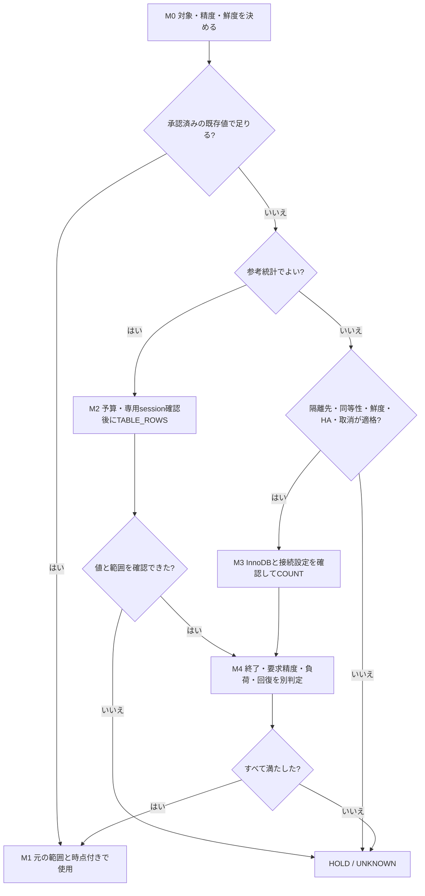

# MySQL：大規模テーブルの全件数取得ガイドライン

> Q&A・実行フロー追補の受入状況は[確認記録](../../results/reviews/qa-products/acceptance.json)で確認します。旧Issue 3受入は修正前hashのみが対象です。

[全件数取得のQ&Aと精度の観測方法](#qa)

ここでいう「データ量」は、**業務上のWHEREを付けない表全体のROW COUNT**です。容量bytes・割当量、アプリの有効件数、soft-delete除外件数は別指標です。
正確値も読取snapshotに見える行数であり、未コミット行・削除済み物理版の総数ではありません。サポート中のMySQLを対象とし、採用版のサポートと機能を所有者が確認します。
**承認済みexport → 対象限定の参考統計 → 必要な場合だけ事前適格化した資源隔離先の通常COUNT**を基本経路にします。
「最適」は必要精度・鮮度・期限・サービス予算を満たす候補で追加取得費用が小さいことです。全条件最速、ゼロ負荷、スキーマロックなし、行数Nだけの安全閾値は約束しません。

## このファイルの読み方と性能調査の根拠

[実行フロー](#実行フロー)で方式を選び、このファイル内の対象条件・SQL・停止／終了／回復条件を確認し、[Q&A](#qa)で判断理由を確認します。巨大表の正確COUNTは適格な資源隔離先が前提です。参考統計と正確値、観測上の精度と保証を分け、条件不明ならHOLDにします。

DBでの性能調査を詳しく確認する場合は、[検証条件・費用比較の説明](../table-count-calibration.md#4-代表fixtureと条件付き標本の位置付け)、[COUNT／統計の費用比較JSON](../../results/reference/review-20261107T155750Z-26743/results/requested_accuracy_cost_frontier.json)、[詳細検証ガイド](../table-count-guideline.md)、[実行の完了証明](../../results/reviews/final-all-proof.json)へ進みます。これらは凍結した専用labの根拠です。RDSでの重いSELECTによる悪化率は未計測で、本番の性能予測へ転用しません。

## 実行フロー

図のM番号は下の操作表に対応します。SQLはその操作の前提確認後だけ実行します。図中のHOLDはSQLを発行せず、所有者へ精度・鮮度・設備の見直しを返すことです。[接続先・索引・暗号化・精度のQ&A](#qa)



| 操作 | 実行内容・次の判断 |
|---|---|
| M0 | 全行かアプリ可視行か、対象世代、許容時点、精度上限の必須性を確定。条件付き件数は別要件 |
| M1 | export・分析側指標の変換/削除反映と元表対応を確認。copyの値をprimary現在値と表示しない |
| M2 | [§3](#3-対象限定で参考統計を取る)の初期化・identity確認後、同節のTABLE_ROWS SQL。0/NULL/欠落は空表認定にしない。誤差上限必須ならM3の適格化へ |
| M3 | [§4](#4-正確値は適格な隔離先で数える)の全条件を満たし、§3初期化済みの同sessionで通常 `SELECT COUNT(*) FROM db.t`。実際の安全な識別子引用付きSQLは§4。非InnoDB/特殊形式は§2の専用経路へ、既定primary走査へ戻らない |
| M4 | [§6](#6-開始停止終了回復チェック)とrunbookの監視・取消・server終了・回復確認。timeout/role失効/監視不能は新規投入停止、所有確認して取消。終了不明なら次表へ進まない |

実行中の停止条件はM2/M3双方に適用します。図の正常矢印はtimeout後の自動retryを許可しません。経験的な精度でよい場合は[Q&Aの校正手順](#q-自分の表の誤差をどう観測するか)を使い、条件不一致・上限必須なら参考値だけで終了しません。

## 1. 最初の選択

1. 所有者、DB/表/シャードと世代、全行か業務可視範囲か、必要精度・許容時点・期限を確定します。
2. 既存の承認済み台帳・監視exportに要求を満たす値があれば、取得元・時点・精度種別を付けて使います。
3. 粗い規模でよければ、追加取得予算のある接続先だけで§3のTABLE_ROWSを取得します。統計照会も無料ではありません。
4. 誤差の経験的見込みでよければ、同条件の校正を確認します。必須の誤差上限・正確値なら§4へ進みます。
5. 実行先のデータ同等性・HA role・資源分離・鮮度・監視・取消・終了確認が成立しなければ、参考値への精度緩和、古い隔離コピーへの鮮度緩和、設備追加のいずれかを所有者へ返して保留します。

| 必要精度・鮮度 | 最初に選ぶ方法 | 結果の表示と不足時の分岐 |
|---|---|---|
| 既存値の時点でよい | 承認済みexport | 元の方式・時点を継承。値だけを「現在値」にしない |
| おおよその規模 | I_S.TABLES.TABLE_ROWS | 参考統計、誤差上限なし。鮮度不明は不明と記録 |
| 条件付きの経験的精度 | 同世代・同時点の真値と照合した統計 | 条件・観測誤差付き。条件不一致なら参考値か隔離COUNT |
| 条件付きの確率区間が使える | 適格な隔離先の標本prototype | §5の全条件を証明。未達は要求精度についてUNKNOWN |
| 必須の誤差上限／正確値 | 適格な隔離先のCOUNT(*) | そのsnapshotの正確値。鮮度不足なら要求未達 |
| primary現在値・全シャード同時点が必須 | 整合性を設計した常時計数や固定復元点等を別途設計 | 別snapshotのCOUNT合計で代用しない。経路がなければ保留 |

## 2. 表状態を組み合わせて選ぶ

下表の物理状態に、続く活動・権限・取得先の条件を重ねます。例えば「文字列PK＋100列＋TDE＋更新中」も、SQLで読める通常InnoDBなら同じ基本経路です。
個別状態の性能が未計測でも通常COUNTの意味は変わりません。PKや行幅が不明なだけで適格な隔離先のCOUNTを放棄せず、費用を未校正として予算で制限します。

| 物理・統計状態 | 参考値／正確値への経路と注意 |
|---|---|
| InnoDB BASE TABLE、空・極小・巨大 | export/TABLE_ROWS → 必要なら隔離COUNT。参考0や小さい推定からprimary走査を許可しない |
| PKあり／なし、整数／文字列／複合、欠番・疎・偏在 | 同じ経路。AUTO_INCREMENT、MAX−MIN+1、ID範囲は件数の代用にしない |
| 二次索引なし／狭い索引／複数／invisible | 同じ経路。隔離先で既存索引と通常EXPLAINを確認。PRIMARY強制・索引作成・可視性変更を自動化しない |
| 80/100列、可変長・外部LOB・行外格納、圧縮 | 同じ経路。列数から実読取bytesや安全性を決めず、索引・割当・更新状況を見る |
| partition表全体 | TABLESの表1件を使用。正確値は表全体COUNT。TABLESとPARTITIONSを足したり、重複行を合計しない |
| partition別の件数が必要 | 全表件数とは別の要件。所有者がpartition識別・世代・同一snapshotを設計。更新中の個別COUNT合計を全表正確値にしない |
| cache warm/cold、不明、古い／未初期化統計 | 正確COUNTの経路は同じ、費用は別条件。統計の初期化・鮮度不明は校正を棄却し、cache flushや自動ANALYZEをしない |
| metadata既知の正値／0／NULL／欠落／拒否 | 正値も参考。0は空表の証明なしなら要求件数UNKNOWN。NULL・欠落・拒否も理由付きUNKNOWN、エラーを0へ変換しない |
| TDE、サーバー鍵が利用可能 | 同じ経路。SQLクライアントがseedを知らなくてもサーバーの鍵利用が前提 |
| TDE鍵なし／暗号化backupの復元 | 所有者がkeyring・鍵・復元手順を用意。サーバーが読めなければ取得不可、ファイルだけからCOUNTできるとしない |
| アプリ暗号文、client seed不明 | サーバーがSQLで表を読めれば平文解釈なしのCOUNTへ。接続・権限・実driverの対応は確認し、復号式を追加しない |
| 非InnoDB、MyISAM、MEMORY等 | 承認済みexport・エンジン別の参考台帳を使用。所有者が専用隔離先／export手順を指定し、InnoDBの非ロック性や本番COUNTを転用しない |
| temporary／session-local、view | TABLESではtemporaryが列挙されない。作成sessionの所有者台帳、view定義・可視範囲に対応したexport／隔離手順を用意。欠落を0にしない |
| 外部・remote storage、非標準形式、種別不明 | 接続先・エンジン・remote側影響を所有者が特定。承認済み参考値か専用exportを使い、generic COUNTに自動投入しない |

TABLESの表種別・推定値・temporaryの制約は[公式仕様](https://dev.mysql.com/doc/refman/8.4/en/information-schema-tables-table.html)、invisible索引は[公式仕様](https://dev.mysql.com/doc/refman/8.4/en/invisible-indexes.html)を参照します。
TDEのサーバー側鍵要件は[公式暗号化仕様](https://dev.mysql.com/doc/refman/8.4/en/innodb-data-encryption.html)に従います。アプリ暗号文の扱いはCOUNTの意味からの推論で、実アプリ性能の観測ではありません。

| 活動・権限・取得先 | 重ねる条件／戻り先 |
|---|---|
| INSERT/UPDATE/DELETEが多い、長い未終了transaction | 同じ参考／隔離COUNT経路。統計誤差・snapshot時点・undo保持と複製適用を監視。未コミット行を含めない |
| soft-delete・tenant・権限制限 | 全表COUNTはsoft-delete行も含む。viewやアプリの可視件数は別要件。主体・範囲を合わせ、全表統計をtenant正確値と表示しない |
| DDL/rebuild/移行/TRUNCATE中、世代不明 | 名前だけで同一表としない。所有者の変更台帳で世代と完了を確認し、競合中は新規投入停止。安定した隔離コピーか保留へ |
| primaryだけがある | 既存exportか予算付き参考統計まで。粗い小表推定はprimary COUNT許可ではない。正確値は隔離先を用意するか保留 |
| 専用replica | データ同等性、HA role、資源、鮮度を別々に適格化（§3・§4）。GTID追随やlag 0だけでは採用しない |
| 共用replica／共有資源 | replicaという名前だけで許可しない。競合を隔離・制限できなければ独立した復元コピーへ |
| 独立した承認済み復元コピー | 完全なbackup・復元／適用来歴、対象世代・鍵・固定復元点と許容鮮度、HA対象外である承認を確認。作成作業自体にも元DBの予算が必要 |
| 取得先なし／不明、shard欠落 | 取得済み分の小計と欠落一覧を返す。全体はINCOMPLETE、UNKNOWNを0として合計せず、必要設備・担当を明示 |

## 3. 対象限定で参考統計を取る

**コピー前に**所有者の接続・lock待ち・実行・総時間予算とdriver deadline、監視・取消担当を確定します。下の3秒・1000msは設定例であり、本番安全値ではありません。
自動transaction参加を無効にした新規・非pool・専用sessionを使い、既存transactionがないことを接続側でも確認します。既存の仕事にautocommitを設定してcommitしないでください。
表に触る前に初期化します。失敗・想定外の設定は停止。対象DB/表は承認済み台帳から限定し、高価な全サーバー探索をしません。
HA所有者の既存トポロジexportでrole・昇格候補・topology/routing epoch・採取時刻／許容age・イベント源・承認を確認し、下の実server UUID・read_only/super_read_only、承認channelのSHOW REPLICA STATUSのChannel_Name/Source_UUIDと照合します。実際のGR構成だけは既存P_Sのmember role/stateも使用します。[読取観測・権限と失効手順](operations-runbook.md#3-mysql接続所有mdlundo複製)
台帳と現物の不一致・role不明はHOLDとし、観測のためにGRANT／global instruments／構成を自動変更しません。read_onlyフラグやchannelの存在だけを権威あるrole判定にしません。フラグは変更可能な現状態で、過去のlocal writeなしも証明しません。[read_only公式](https://dev.mysql.com/doc/refman/8.4/en/server-system-variables.html#sysvar_read_only)・[replica status](https://dev.mysql.com/doc/refman/8.4/en/show-replica-status.html)

```sql
SET SESSION autocommit = 1;
SET SESSION TRANSACTION ISOLATION LEVEL READ COMMITTED;
SET SESSION lock_wait_timeout = 3;       -- 例：所有者予算へ置換
SET SESSION max_execution_time = 1000; -- 例：driver期限も別途設定
SELECT CONNECTION_ID(), @@server_uuid, @@hostname, @@version, @@session.autocommit,
       @@session.transaction_isolation, @@session.information_schema_stats_expiry,
       @@global.read_only, @@global.super_read_only;
SELECT TABLE_SCHEMA, TABLE_NAME, TABLE_TYPE, ENGINE, TABLE_ROWS,
       AVG_ROW_LENGTH, DATA_LENGTH, INDEX_LENGTH, CREATE_OPTIONS, UPDATE_TIME
FROM information_schema.TABLES
WHERE TABLE_SCHEMA = 'db' AND TABLE_NAME = 't';
```

返却したserver identity・DB/表名・TABLE_TYPE・ENGINEを照合し、InnoDB BASE TABLEだけを通常COUNT経路へ送ります。結果なしは「存在しない」と断定せず、非可視・temporary・変更中も確認します。
既存の`information_schema_stats_expiry`は変更しません。0なら毎回engine取得、非0でもcache miss/期限切れでengine読取が発生し、cache-onlyにはできません。
TABLE_ROWSは推定、UPDATE_TIMEは統計更新時刻ではありません。SHOW TABLE STATUS・n_rows・EXPLAINの一致も独立した精度証明ではありません。
割当量は容量の概数でCOUNTの実読取量ではありません。未知・0参考値を別欄に残し、空表認定は同世代・適切な時点の独立した正確値等によります。
DB・共有ストレージ単位で対象を小分けにし総時間も制限します。自動ANALYZE、索引新設、cache flush、実行を伴うEXPLAIN ANALYZEは行いません。

## 4. 正確値は適格な隔離先で数える

次のgateを独立に記録し、すべてを満たした取得先だけで実行します。[runbookの記入欄](operations-runbook.md#1-採用前の記入欄)に根拠・適用範囲／表世代・確認時刻・承認者を残します。

- **データ同等性（DATA EQUIVALENCE）**：source UUID／channel→元schema/table/世代→コピー側schema/table/世代の対応を所有者台帳で確認。名前書換え・multi-sourceの全関係、現在と過去のsource/binlog filter・replicaのchannel/global filterを含めます。初期コピーの完全性と、その後すべての再seed・rebuild・DDL、skip・空GTID・手動repair・local writeの履歴を、既存の承認済み整合性監査／変更記録で確認します。「履歴なし」は根拠なしに記入しません。[初期データ](https://dev.mysql.com/doc/refman/8.4/en/replication-setup-replicas.html)・[filter仕様](https://dev.mysql.com/doc/refman/8.4/en/replication-rules.html)・[skip仕様](https://dev.mysql.com/doc/refman/8.4/en/replication-administration-skip.html)
- **鮮度（FRESHNESS）**：同等性が適格でも、許容snapshot点、復元／適用位置と採取時刻、実COUNT snapshotとの対応限界、lag・許容ageを別判定。GTIDやlag 0からprimary現在正確値とはしません。
- **資源**：CPU/I/O/memory・共有host/storage/network・通常読取／apply余力と上限、監視・取消・回復余力を確認。監視だけでは資源分離を代替できません。HA roleの継続適格性も§6で確認します。

replicaでfilterされたtransactionもGTIDは保存されるため、現在のGTID・lag・フラグでは来歴を証明できません。[GTID Life Cycle](https://dev.mysql.com/doc/refman/8.4/en/replication-gtids-lifecycle.html)に基づく採用方針です。同等性が不明なら、COUNTが正常終了しても正確なのは**このコピー自体のsnapshot件数だけ**です。元サービス表の正確件数要求は**UNKNOWN/HOLD**に戻し、鮮度良好で覆しません。確認のために本番COUNT／全表checksum／ANALYZE／repair／filter変更を自動投入せず、既存承認記録で不足なら保留します。
§3と同じ新規専用sessionを表に触る前に初期化し、予算を設定し直します。下は同sessionで確認済みの識別子を安全に引用した例です。

```sql
SELECT /* count_job: replace_with_unique_job_id */ COUNT(*) AS exact_rows
FROM `db`.`t`;
```

通常のRCまたはRR、autocommit=1の1文を使います。`COUNT(*)`はNULLのある行も数えます。COUNT(nullable列)は代用不可、COUNT(1)も高速化策にはしません。[COUNT公式](https://dev.mysql.com/doc/refman/8.4/en/aggregate-functions.html#function_count)
通常SELECTは行ロックを取りませんが、MDL・DDL待ち・undo保持・CPU/I/O競合は残ります。[整合性読取](https://dev.mysql.com/doc/refman/8.4/en/innodb-consistent-read.html)・[MDL](https://dev.mysql.com/doc/refman/8.4/en/metadata-locking.html)
FOR SHARE/FOR UPDATE、SERIALIZABLE、LOCK TABLES/FTWRLは除外します。DML/CTAS/SETへCOUNTを埋め込む形は通常SELECTと異なり読み取り元をロックし得るため使いません。
partitionも表全体を1文で数えます。別文・別表・別シャードのsnapshotは別時点で、更新中の合計を「全体の現在正確値」と呼びません。
GTIDや遅延0もCOUNTのsnapshotとprimary現在値の一致を証明しません。同時点必須なら固定した隔離復元点等を用意し、鮮度要件を満たせなければ要求未達です。

## 5. 校正・標本を選べる条件

統計の校正は同じ表世代・統計profile・統計時点・真値時点・版・sample pages・変更条件に対応付けます。行幅、PK、partition、暗号化、cache等の費用条件も記録します。
論理復元や再構築で配置・統計が変わるため、復元先の誤差から古い本番cache統計の誤差を認定しません。未知・不一致・大量変更後は校正を棄却します。
標本はSQLで見える一意整数PK、固定snapshot、セル上限、無作為抽出、停止規則、誤差確率配分等の**全適格条件を証明した隔離先**だけのprototypeです。
文字列PK・PKなし・極端な欠番や偏在で条件が成立しない場合は参考統計か通常COUNTへ戻ります。標本0から空／小表と推定せず、反復の安定を精度認定にしません。
信頼区間、今回の実現誤差、将来保証を分けます。詳細は[校正手順](../table-count-calibration.md)と[標本仕様](../probability-count.md)を参照し、初回台帳取得の既定にしません。

## 6. 開始・停止・終了・回復チェック

- **開始**：対象・世代・主体・権限・取得先とデータ同等性・HA role・鮮度を確認。実行担当と別管理接続の監視／取消担当を置き、所有処理の識別・取消・終了確認ができなければ開始しません。
- **予算**：平常p99・失敗率・CPU・I/O・待機・複製遅延・DDL待ち・長いread view/undoを確認。所有者が資源上限、観測間隔、停止値、回復窓を記録します。
- **期限**：検出・取消遅延を見込みSLO違反より手前で止められる余裕を確保。文上限・MDL待ち上限・driver command timeout・呼出し全体のdeadlineを併用します。
- **投入**：共有資源単位でもまず直列。行数Nや列数だけで並列数・安全閾値を決めず、余力を確認してのみ拡大します。
- **停止**：昇格・role/topology/routing/epoch変更、roleの期限切れ・取得不可・不明で適格性は失効します。停止値到達、監視不能、想定外DDL/負荷でも新規投入停止。取消担当は接続ID・一意jobタグ・取得先・account・開始文脈で現在の所有queryを照合してKILL QUERY等の承認済み取消を行います。
- **終了**：古いIDの再利用先を盲目的にKILLせず、server上の文・transaction終了を確認。driver timeout・切断だけで完了とせず、終了不明なら次の表へ進みません。
- **回復**：取消後もcache/I/O・undo等を回復窓まで監視し予算内へ戻ることを確認。自動再試行せず、失敗はUNKNOWNと理由を保存します。
- **判定**：処理完了、要求精度、サービス予算、後始末を別々に記録。未開始・未完了・timeoutを落としてSLO合格にしません。[取消仕様](https://dev.mysql.com/doc/refman/8.4/en/kill.html)

実行前に[運用runbookの記入済み独立復元先／専用replica例と空欄template](operations-runbook.md#1-採用前の記入欄)を埋めます。共有host/storage/networkと実際の上限機構を確認し、CPU/memory制限やResource GroupsだけでI/O上限を認定しません。検出・配送・判断・取消・rollback・jitterの時間上界より長い停止余裕を確認し、p99のms差から余裕秒を推定しません。
[具体的観測SQL・権限](operations-runbook.md#3-mysql接続所有mdlundo複製)ではP_S threadsとconnection所有台帳、MDL、INNODB_TRX/undo、replica適用状態を追跡します。instrumentation不足・部分可視・権限拒否はunavailableで停止し、global instrumentsを自動有効化しません。KILL QUERYだけではtransaction/read view解放を保証しないためclient finallyが自分のtransactionを回収し、所有接続とserver終了を確認します。識別不一致や終了不明では再投入しません。
HA変更で失効した結果は承認までHOLD。自動再接続・再試行は禁止し、driver/proxy retryで新しい物理sessionになった場合もidentity・role・データ同等性・資源・鮮度をすべて再適格化します。実backendと専用leaseを固定・観測できなければHOLDです。
昇格候補はHA所有者の手順・イベントと停止gateを連携し、必要な場合は昇格後にサービス負荷を受け入れる前の取消・保持解除ackまで確認します。連携できなければ独立復元先へ戻します。ポーリングは検出遅延を狭めるだけで、競合なくprimary負荷を防ぐ保証ではありません。HAを優先し、COUNT終了を必須failoverの妨げにしません。終了不明はincidentへ引継ぎ、新規COUNTを禁止します。これは[roleの現状態仕様](https://dev.mysql.com/doc/refman/8.4/en/performance-schema-replication-group-members-table.html)と[取消の制約](https://dev.mysql.com/doc/refman/8.4/en/kill.html)を踏まえた運用方針です。[共通の失効・HA引継ぎ手順](operations-runbook.md#1-採用前の記入欄)を満たせない／連携未検証ならHOLDとし、自動failover実験は要求しません。

## 7. 表・シャードごとの記録と観測限界

各行に、job ID、DB/表/シャード・世代、対象範囲・主体、取得先identity/版/role、HA所有者・topology/routing epoch・採取時刻／age・イベント源・承認、同等性監査のscope/世代/時刻、方式、値またはUNKNOWNと理由を保存します。
精度種別（参考／経験的校正／条件付き区間／正確snapshot）、開始終了時刻、snapshotの説明、GTID等の取得位置とその取得時刻、backup/復元点、遅延・許容鮮度、校正条件を添えます。
snapshotとログ位置を対応付けられない場合はその限界も残し、取得位置をCOUNTの厳密なsnapshot IDとして偽装しません。各予算、到達停止値、取消、server終了、回復、後始末を記録します。
期待shard一覧と取得済み一覧を突合し、欠落・UNKNOWN・異なる範囲／精度／時点を明示。互換な取得済み値だけの小計とINCOMPLETEな全体を分けます。

過去に採用された[凍結実行の統計JSON](../../results/reference/review-20261107T155750Z-26743/results/requested_metadata_accuracy.json)と[極値監査](../../results/reference/owner-acceptance-20261107T161659Z/reports/owner-essential-fresh-metadata-extrema.json)では、非空InnoDB55表の各1観測、既定cache・20 pagesで、ANALYZE前の500,000行が621,877行（+24.3754%）、後の1,000,000行が1,195,881行（+19.5881%）でした。
これは一律10%を超える例で、全条件の誤差上限ではありません。小表一致、ANALYZEやpage増量も精度保証にしません。費用比較は[校正資料の条件付き比較](../table-count-calibration.md#4-代表fixtureと条件付き標本の位置付け)へ進みます。
[所有者proof](../../results/reviews/final-all-proof.json)の縮小白紙実行は8.4/9.7/26.10系の専用コンテナ観測です。環境・cache・実行順の制約があり、本番SLOや最速順位は未認定です。
[費用比較の元JSON](../../results/reference/review-20261107T155750Z-26743/results/requested_accuracy_cost_frontier.json)は8.4.13・buffer pool 256 MiB・parallel read threads=1の専用labです。host/VM cacheと先行COUNTの持越しは未制御で、本番hardwareの性能予測に使いません。
1億行の細表と75万行の50/100列TDE表は別条件です。**1億行×80/100列×TDE、実アプリ暗号化、物理replica分離、本番のcold/warm性能は未計測**で、組み合わせて外挿しません。
既存の旧観測・当時の採用実行・却下された時計窓を混ぜない根拠と完全logは[凍結詳細ガイド](../table-count-guideline.md)・[校正資料](../table-count-calibration.md)に保存されています。利用者がlabやRielaを実行する必要はありません。
labのreplicaは`t_repl`だけを複製します。その良好なlagから他表の複製範囲・同等性を認定しません。filter／driftやHA連携の新実験は行っていません。
監査付記：現行版の受入可否と対象hashは[Q&A追補受入記録](../../results/reviews/qa-products/acceptance.json)を照合します（所有者確認・別セッションSol 2役の結果と対象hashを確認し、記録なし・不一致は受入保留）。[Issue 2修正前snapshot](../../results/reference/issue-2-pre-fix-de1c79c/manifest.json)と保存された[Issue 1受入](../../results/reference/issue-2-pre-fix-de1c79c/results/reviews/issue-1/acceptance.json)は旧hashだけの証跡です。最終査読後に変更したhashは再査読が必要です。今回の文書修正は既存実行や本番SLOの再認定ではありません。

[Issue 3修正前snapshot](../../results/reference/issue-3-pre-fix-16cc9b3/manifest.json)と[歴史的Issue 2受入](../../results/reference/issue-3-pre-fix-16cc9b3/results/reviews/issue-2/acceptance.json)は保存された旧hashだけに適用します。現行Issue 3集約受入は所有者の専用実行・意味/source/後始末監査と別セッションSol 2役の最終査読の完了を条件とします。記録なし・hash不一致はHOLDであり、受入済みとは扱いません。


## QA

### Q COUNTは必ずread replicaで実行するのか

A 必ずreplicaという意味ではありません。このガイドでは、巨大表の正確COUNTは**事前適格化した資源隔離先**で行います。専用の分析replica、独立した復元コピーが候補です。業務primaryしかない場合は既存exportか予算付き参考統計までとし、正確値は設備・鮮度・精度の見直しへ戻します。

replicaでもアプリの読取を受け持つ、storage/networkを共有する、複製適用が詰まる場合はサービスへ影響します。HA昇格候補はrole変更と取消を連携し、連携不能なら独立復元先へ。server UUIDだけでなく実role、同等性、遅延、上限、取消経路を[runbook](operations-runbook.md)で確認します。read_onlyフラグは無負荷の保証ではありません。

### Q RDS read replicaに重いSELECTを流すと、writeやサービスのread性能へ影響するか

A **同じreplicaを使うサービスのreadは遅くなり得ます。primaryのwriteへの直接影響は通常限定されますが、間接影響はあり得ます。** ここではAuroraではない、通常のRDS for MySQL DB instanceの非同期read replicaと、通常InnoDBのRC/RRにおける非locking SELECTを対象にします。

| 影響先 | 起こり得ること |
|---|---|
| 同じreplicaへのサービスread | 重いSELECTとCPU・I/O・buffer pool等を共有するため、応答時間やtimeoutが悪化し得る |
| replicaのデータ鮮度 | SELECTと複製適用が資源を競合し、適用が遅れるとReplicaLagが増える。読取が速く返っても古いデータになり得る |
| primaryのwrite | 非同期複製なので、そのSELECTの終了やreplicaの適用完了を通常のcommitが待つ仕組みではない。replica側SELECTの行ロックがprimaryへ伝播するわけでもない |
| primaryへの間接影響 | 大きな複製遅延に伴うsource側binlog蓄積・空き容量低下、アプリが遅いreplicaからprimaryへreadを迂回する場合の追加負荷などに注意する |

非同期複製とDB instance分離は[AWS RDSの構成仕様](https://docs.aws.amazon.com/AmazonRDS/latest/UserGuide/USER_ReadRepl.html)によります。資源競合と迂回による影響はその構成からの運用上の推論で、悪化率はこのrepoでは未計測です。遅延が大きい場合のbinlog蓄積は[AWSの遅延対処資料](https://repost.aws/knowledge-center/rds-mysql-high-replica-lag)にも記載されています。適用だけが遅いのか、ログ受信も遅いのかを分け、ReplicaLagだけでsourceの容量増加を断定しません。

通常SELECTでもreplica内のMDLや長いsnapshotの保持は残り、DDL適用や後処理へ影響し得ます。行ロックを取らないことは、無負荷を意味しません。Aurora reader、RDS Multi-AZ DB clusterのreader、RDS for SQL Serverは複製・storage・commitの条件が異なるため、このprimary影響の説明を転用しません。Multi-AZ DB instanceの読取不可standbyとも区別します。

### Q サービスのread性能への影響を最小限にするには

A **サービスのreadを受けない、適格化した分析専用replicaか独立復元先で実行することを優先します。** AWSもレポート・DWH用途のread replicaを案内しています。[公式の用途例](https://docs.aws.amazon.com/AmazonRDS/latest/UserGuide/USER_ReadRepl.html#USER_ReadRepl.Overview)

1. **接続先を分ける。** サービス用と集計用の接続先・pool・routingを分離し、集計専用replicaへサービスreadが流れないことを確認します。HA昇格候補ならrole変更時の取消も必要です。独立復元先は継続複製の競合を避けられますが、元表との同等性・復元点・鍵・鮮度を別確認します。
2. **走査を減らす。** 要件を満たす既存export・時点付き件数cache・参考統計を優先。正確COUNTが必要な場合だけ実行し、共有資源単位でまず1本、低負荷時間帯から始めます。索引の一律新設やhint強制は行いません。
3. **開始前に予算と取消を決める。** 通常時のサービスp95/p99応答時間・error率、replicaのCPU・read latency/queue・空きメモリ、ReplicaLagと複製稼働状態、primaryのwrite応答時間・BinLogDiskUsage・FreeStorageSpaceを確認します。許容悪化幅・鮮度上限・実行期限・観測間隔を所有者が定め、監視不能なら開始しません。汎用の「CPUが何%なら安全」という基準は置きません。
4. **悪化時は集計を止める。** サービス応答・error・鮮度・資源予算のどれかが上限を超えたら、[runbook](operations-runbook.md)で所有確認した集計queryを取消し、server側の終了・transaction終了と回復を確認します。timeout直後の再試行や並列追加はしません。通常の複製適用をCOUNTのために止めません。
5. **迂回と終了後も見る。** サービス側のprimaryへのfallback・retry増幅を確認し、集計からprimaryへ自動再試行しません。query終了だけで回復とはせず、サービスreadと遅延・資源が許容範囲へ戻るまで次を開始しません。

サービスと同じreplicaしか使えない場合、閑散時間帯や直列化は軽減策にはなりますが、無影響の保証にはなりません。このガイドの巨大表の正確COUNTは、資源隔離先の適格条件を満たせなければHOLDとし、設備・取得頻度・精度要求を見直します。

### Q 重いクエリは1本だけ。それでも大きな影響が出るのか

A **必ず大きな影響が出るわけではありません。1本という本数だけでは判断できません。** 余力が十分で、scan対象がcacheに収まり、サービスとの競合が小さければ、許容範囲に収まることもあります。一方、1本でも大きなindex scanがI/O帯域を使う、buffer poolの入替えが増える、長いsnapshotを保持する、といった条件でサービスreadや複製適用の余力を削り得ます。CPU全体に余裕があってもI/Oが詰まる場合があります。

無条件COUNTは結果が1行でも多数のページを読む場合があり、返却行数と作業量は別です。「遅いSQLが1本ある」こと自体より、実行前後のサービス応答・error、I/O待ち、ReplicaLagの変化を予算に照らして判断します。一般の重いSELECTにはjoin/sort等もありますが、単純COUNTにそれらの費用が必ず発生するという意味ではありません。影響の大きさは未計測で、一律に危険とも安全とも認定しません。

### Q slow query logに出ることも注意すべきか

A **出力条件に該当すれば記録されるため、既存の監視運用に合わせて実行を識別できるようにします。** RDS for MySQLではslow_query_log、long_query_time、log_output等の実効設定を対象replicaで確認します。CloudWatch Logsへの出力は別途export設定も必要です。短時間でも索引を使わないqueryを記録する設定等があるので、時間だけで出力有無を断定しません。[AWSのログ仕様](https://docs.aws.amazon.com/AmazonRDS/latest/UserGuide/USER_LogAccess.MySQL.LogFileSize.html)

- 1回の長いCOUNTが、scanした行の数だけslow logへ出るわけではありません。通常は実行したstatementの記録です。1本の短いSQLを1回記録する費用だけで大きな劣化が起こると決めつけず、query本体のscan費用とログ書込費用を分けます。ログ費用はこのrepoでは未計測です。
- 定期実行・timeout後の再試行・多数表の連続実行で記録数が増える場合や、TABLE出力・大きなSQL本文・低すぎる閾値では、ログI/O・容量・CloudWatch取込／保持費用も確認します。AWSは性能面でFILE出力を推奨していますが、COUNT一回のため既存設定を自動変更しません。[AWSの性能上の推奨](https://aws.amazon.com/blogs/database/performance-optimization-strategies-for-mysql-on-amazon-rds/)
- 専用ユーザー・接続先・実行時刻・機密を含まないjob IDを台帳に残します。SQLコメントの保持やアラート側の識別可否は実際の収集経路で確認し、コメントだけへ依存しません。ログにSQL・schema名等が残ることを考慮し、コメントへ個人情報や秘密を入れません。
- slow log連携の通知がある場合は予定集計と識別します。予定queryであることだけを理由にサービス悪化の通知を抑止せず、遅延・error・複製の監視は維持します。ログに出ないようslow logを無効化したり閾値を上げたりして、安全性の代用にはしません。

slow logに載ったことは実行時間等が出力条件を満たした証拠であり、サービス性能が悪化した証拠とは別です。また、通常はstatementの実行後に記録されるため、実行中queryの監視・取消をslow logの到着だけに依存しません。[MySQL slow query log仕様](https://dev.mysql.com/doc/refman/8.4/en/slow-query-log.html)

### Q サービスDBとは別に分析用replicaを置く構成は一般的か

A **ベンダーが公式に案内する標準的な構成パターンです**。AWSはRDS read replicaを読取負荷分散の仕組みとして提供しています。普及率を示す調査ではなく、構成例としての根拠です。[AWS公式](https://aws.amazon.com/rds/features/read-replicas/)

既存の分析replicaがあるなら、まず対象表の複製範囲と鮮度を確認します。新設はストレージ・運用費用、初期コピーと複製による元DBへの負荷を伴うため、COUNT一回のために自動作成しません。頻繁なレポートなら継続的な分離を検討し、まれな件数確認なら既存backupの独立復元が候補です。これは用途に応じた選定方針で、性能の一律優劣ではありません。

### Q 分析基盤や集計テーブルがあればそこで数えてよいか

A 元表との対応が証明できれば使えます。ETLで重複排除、削除行除外、履歴追加、tenant限定、joinによる増幅があると同じ件数ではありません。元表世代、変換規則、削除の反映、最終取込点、欠落・再送の扱いを確認します。集計表ならその行数をCOUNTするのではなく、承認済みの「元表件数」指標を読みます。対応不明なら分析側の件数と表示し、元表の正確件数要求はHOLDです。

### Q 実行するCOUNTのSQLは

A [MySQLガイド§3の専用接続初期化](mysql.md#3-対象限定で参考統計を取る)と実行先の適格化を済ませた同sessionで、次の1文です。識別子は承認済み台帳から安全に引用します。

```sql
SELECT /* count_job: unique_job_id */ COUNT(*) AS exact_rows
FROM `db`.`t`;
```

通常InnoDBのRC/RR・autocommit=1で使い、FOR UPDATE/FOR SHARE、SERIALIZABLE、DML/CTASへの埋込みへ変更しません。COUNT(nullable列)はNULLを除くので代用不可。COUNT(1)への変更も高速化策にはしません。[MySQL COUNT仕様](https://dev.mysql.com/doc/refman/8.4/en/aggregate-functions.html#function_count)

### Q PKや二次索引によってSQLを変えるのか

A 基本は同じCOUNT(*)です。InnoDBは通常、利用可能な小さい二次索引を走査し、なければclustered indexを走査します。索引・行幅・cache・MVCCで費用が変わるので、事前適格化した隔離先で通常EXPLAINを確認します。無条件COUNTは「索引があるので一瞬」とは限りません。[公式仕様](https://dev.mysql.com/doc/refman/8.4/en/aggregate-functions.html#function_count)

FORCE INDEX/PRIMARYを一律に付けたり、COUNTのため本番へ索引を新設したりしません。文字列PK・複合PK・PKなしでも通常COUNTの意味は同じです。索引選択の変更を試すなら別の隔離検証として費用・計画を比較します。

### Q 暗号化や100列、1億行ならSQLを変えるのか

A サーバーが通常SQLで読めるInnoDBならCOUNT(*)のままです。TDEはサーバーの鍵が利用可能であることが前提で、backup復元には鍵の準備も必要です。アプリ暗号文は行を数えるための平文復号式を追加しません。ただし接続・権限・driverの対応は確認します。[MySQL暗号化仕様](https://dev.mysql.com/doc/refman/8.4/en/innodb-data-encryption.html)

データ量で変えるのは接続先、時間・I/O予算、実行頻度と採用方式です。行数・列数だけから安全時間を算出しません。repoの1億行細表と75万行の幅広表は別条件で、1億行×100列の性能は未計測です。

### 精度と運用の質問


### Q 統計の件数はどれくらい信用できるか

A repoの固定観測を再集計すると次の通りです。各集合の分母を分けています。

| 方法と観測条件 | 観測した精度 | 判断への使い方 |
|---|---|---|
| MySQL非空InnoDB55表、20 pages、ANALYZE前 | 絶対誤差中央値0.2141%、±5%以内50/55、範囲−21.1538〜＋24.3754% | 多くは近いが全表5%以内ではない |
| 同55表、ANALYZE後 | 中央値0.2471%、±5%以内50/55、範囲−18.4832〜＋19.5881% | 更新すれば必ず改善するわけではない |
| MySQL行幅偏りの別fixture、20 pages | ＋4.5604〜＋38.7313% | 上の55表と混ぜず、偏りを別条件として扱う |

元データは[MySQL固定JSON](../../results/reference/review-20261107T155750Z-26743/results/requested_metadata_accuracy.json)。55表集合は各表各phase1観測、非InnoDB3表を除外。−27.785%という過去例は別の初回集合です。自分の表が約91%の確率で5%以内という意味ではありません。[集合別の詳細](../table-count-calibration.md)

5%程度の経験的見込みなら自分の条件で校正し、その観測範囲として使います。5%上限が必須なら統計だけでは採用せず、適格な正確COUNT等へ。真値がない場合はUNKNOWNとし、参考統計としてのみ表示します。

### Q 自分の表の誤差をどう観測するか

A まず「今の本番cache値」と「復元先で再生成された統計」のどちらを評価するか決めます。以下は本番を止めず、既存の承認済み固定コピーで行う流れです。

1. 統計を更新する前の推定E、取得時刻、統計生成時刻または不明、設定、対象世代・行集合を保存。
2. 対応する固定コピーで正確Nを取得。元の本番Eを評価するなら、元Eの評価時点とコピーのデータ時点の対応が必要。
3. コピーへの書込・apply・DDL等がないことを確認し、統計状態を再読取。変わった場合は別観測として区別。
4. N>0なら `100*(E-N)/N` と行数差を保存。N=0は相対誤差を定義せず、未知・timeoutを0扱いしない。
5. 表・条件ごとに中央値、過小／過大極値、±1/5/10%内の件数/有効数、欠測、表数・反復数を記録。更新・再構築・世代変更で適用性を再確認。

統計が古いこと自体は評価対象です。統計生成時刻と評価時刻を別に保存し、評価時点の行集合をNと対応させます。MySQLでも、更新中に順番に取得するだけでは統計値とCOUNTの時点一致を保証しません。固定コピーと来歴を確認します。

### Q 真値なしで誤差率を計算できるか

A 今回確認した公式のmetadata項目だけでは得られません。sample pagesは誤差率ではありません。繰返し同じ値が返ること、SHOW/EXPLAIN等の一致も真値への近さを証明しません。[MySQL統計](https://dev.mysql.com/doc/refman/8.4/en/innodb-persistent-stats.html)

既存の正確な基点と、欠落・重複・rollback・DDLを扱った完全なcommit済み増減台帳があれば真値を再構成する選択肢はあります。単なるDML回数では不十分です。COUNTのために本番へ新しいtrigger/CDCを無断導入しません。

### Q 大量の表を並列に数えれば速いか

A 個々のCOUNTが予算内でも合計I/O・CPU・undo保持が予算を超えます。共有資源単位でまず直列。取得済みの値を時点付きで再利用し、必要頻度を減らします。並列化は所有者が合計予算を適格化した場合だけです。別snapshotの表・shard合計を全体同時点の正確値としません。

### Q タイムアウトしたら次の表へ進んでよいか

A server上のquery・transaction終了と回復を確認するまで進みません。所有確認したKILL QUERY等とclient側の後始末を使います。古いIDへ盲目的にKILLせず、不明ならincident担当へ引き継ぎます。[取消と回復の実行手順](operations-runbook.md)

### Q COUNTを毎リクエスト発行するべきか

A UIの概数やレポートなら、要件を満たす既存export・時点付きcache・集計値を優先します。正確な現在件数が必須なら、初期化・増減・再試行・削除・世代変更まで整合する常時計数を別機能として設計します。AUTO_INCREMENT/MAX(id)から行数を作りません。これは頻度と要求を見直す設計方針で、今回のrepoで常時計数を検証したものではありません。


公式資料は2026-11-08確認。構成例は普及率や無劣化の実測ではなく、製品・版・tierごとの条件確認が必要です。
