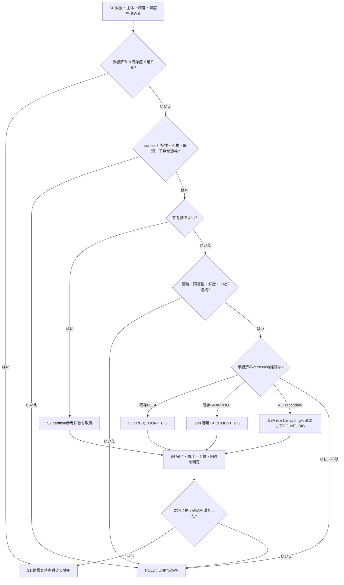

# SQL Server：大規模テーブルの全件数取得ガイドライン

> Q&A・実行フロー追補の受入状況は[確認記録](../../results/reviews/qa-products/acceptance.json)で確認します。旧Issue 3受入は修正前hashのみが対象です。

[全件数取得のQ&Aと精度の観測方法](#qa)

「データ量」は**業務上のWHEREなしの表全体ROW COUNT**です。容量bytes、アプリ有効件数、soft-delete除外件数は別指標です。
正確値も指定した実行主体のsnapshotに見える行数で、全物理版や未コミット行の総数ではありません。採用版・構成のサポートは所有者が確認します。
**承認済みexport → 対象限定のpartition参考行数 → 必要なら事前適格化した資源隔離先のversioned COUNT_BIG**を基本経路にします。
最適性は必要精度・鮮度・期限・サービス予算を満たす候補の追加費用で判断します。普遍的最速、影響ゼロ、スキーマロックなし、一律10%精度、行数Nだけの安全閾値は主張しません。

## このファイルの読み方と性能調査の根拠

[実行フロー](#実行フロー)から対象条件・既存versioning別のSQL・取消／終了／回復条件へ進み、[Q&A](#qa)で判断理由を確認します。巨大表の正確COUNT_BIGは適格な資源隔離先が前提です。locking READ COMMITTED、RCSI、SNAPSHOT、AG secondaryを区別し、条件不明ならHOLDにします。

DBでの性能調査を詳しく確認する場合は、[検証方法・性能結果の詳細](../../results/reference/final-sqlserver-52556dd/docs/sqlserver-table-count-guideline.md)、[COUNT／metadata・サービス負荷の実測JSON](../../results/reference/final-sqlserver-52556dd/results/sqlserver/runs/20261107T230105Z-8533a31e/result.json)、[所有者監査](../../results/reference/final-sqlserver-52556dd/results/sqlserver/owner-audit.json)、[再生成用lab](../../sqlserver/lab.rb)へ進みます。既存labは非サポートのエミュレーション構成で、本番性能やRDSでの悪化率は未計測です。再現スクリプトを実DBへ向けません。

## 実行フロー

図のS番号は下の操作表に対応します。HOLDはSQLを発行せず既存export、精度/鮮度緩和、設備の見直しへ戻る判断です。[接続先・SQL・索引・暗号化・精度のQ&A](#qa)



| 操作 | 実行内容・次の判断 |
|---|---|
| S0/S1 | 元表と分析側の行集合・削除反映・主体/RLS・時点を照合。全体metadataをtenant件数にしない |
| S2 | [§3](#3-identityを確認し対象限定の参考値を取る)のdriver既定拒否・context契約・専用接続初期化・identity確認後、同節の `SUM(row_count)`。heap/clusteredの全partitionのみ。拒否時は権限を上げず同scopeのsys.partitionsかexport。NULL/partition数0はUNKNOWN |
| S3R | [§4](#4-正確値既存versioningと隔離の両方が必要)のRCSI guard＋READ COMMITTED＋COUNT_BIG SQL。既定locking RCをこの分岐へ入れない |
| S3N | 同§4のSNAPSHOT guard＋専用transaction＋COUNT_BIG＋正常COMMIT。attention時はSQL末尾に頼らずclient finallyがrollback/管理経路と終了確認を所有 |
| S3A | 同§4のAG経路。実role/routing・対応disk表・snapshot mappingを承認手順で確認し、通常COUNT_BIG。RCSI guardを無根拠に削除して流用しない。AG固有のprimary側回収も監視 |
| S4 | [§5](#5-開始停止終了回復チェック)とrunbookでrequest・TX・snapshot終了と回復を確認。参考値の「取得完了」は要求精度達成を意味しない |

図に入る前に§2で特殊形式を振り分けます。CONTEXT_INFO業務利用/UNKNOWNはタグ書込み前にHOLD。すべてのSQL経路でtimeout・role失効・監視不能なら新規投入停止、現在の所有処理を確認してCancel/finallyへ。終了不明で次表を開始しません。RCSI/SNAPSHOTの本番自動有効化、NOLOCK/READPAST、盲目的retryは行いません。

## 1. 要求と取得先を先に決める

1. 所有者、DB/schema/表/シャード・世代、実行主体・RLS/tenant範囲、必要精度・許容時点・期限を確定します。
2. 承認済み台帳・監視exportが要求を満たせば再利用。追加SQLには接続・総時間・CPU/I/O・待機・取消の予算を付けます。
3. 規模の参考なら§3、必須の誤差上限・正確値なら§4へ。metadata一致例だけで精度を保証しません。
4. データ同等性・HA role・隔離・versioning・鮮度・監視・取消・回復余力が不足すれば、独立復元先を用意するか、精度／鮮度の緩和を所有者へ返して保留します。

| 要求 | 最初に選ぶ方法 | 表示・不足時の分岐 |
|---|---|---|
| 既存値の時点でよい | 承認済みexport | 元の方式・範囲・時点を継承 |
| 粗い規模 | partition DMV、権限に応じsys.partitions | 参考行数、誤差上限なし。権限なしは管理者の既存exportへ |
| 経験的な精度でよい | 同世代・同時点の真値と照合した参考値 | 条件・観測極値付き。条件不一致なら校正棄却 |
| 必須の誤差上限／正確な可視行数 | 適格な隔離先のCOUNT_BIG(*) | statement/transaction snapshotの正確値、鮮度を別判定 |
| primary現在値・全シャード同時点 | 常時計数・差分整合や固定復元点等を別設計 | 別snapshotの合計で代用しない。経路なしは保留 |

## 2. 状態を組み合わせて基本経路へ振り分ける

物理形状、活動、権限、取得先の各条件を重ねます。「PKなし＋100列＋圧縮＋TDE」等も通常の読取可能disk-based表なら同じ基本経路です。
状態別の性能が未計測でも通常COUNTの意味は変わりません。PK・行幅不明だけで隔離COUNTを放棄せず、費用未校正として上限を設けます。

| 物理・統計状態 | 選ぶ経路と注意 |
|---|---|
| disk-based heap／clustered、空・極小・巨大 | export/partition参考値 → 必要なら隔離versioned COUNT_BIG。参考0・小さい推定はprimary scan許可ではない |
| PKあり／なし、整数／文字列／複合、疎・欠番・偏在 | 同じ経路。IDENTITY、MAX−MIN+1、ID範囲を件数にしない |
| 二次索引なし／狭い索引／複数／filtered | 同じ経路。filtered索引・統計の行数を全表件数にしない。既存索引を確認し、COUNT用索引新設やhint強制を自動化しない |
| 80/100列、LOB・row-overflow、行／page圧縮 | 同じ経路。列数からscan量を決めず、索引・割当・cache・更新状態と予算で判断 |
| partition表全体 | heap/clusteredだけの全partitionを合計。正確値は表全体COUNT。NCIやallocation unitとのjoin重複を加算しない |
| partition単位 | 全表件数とは別。所有者がpartition境界・世代・時点を固定。動くpartitionの別snapshot合計を全表正確値にしない |
| 対応disk-based columnstore | 通常metadataと隔離versioned COUNT_BIGを維持。delta/deletes/遷移を含む参考値に精度保証や最速順位を付けない |
| cache warm/cold、不明、古い／未初期化統計 | 正確値経路は同じ、費用は別条件。optimizer統計とpartition counterを混同せず、取得側からUPDATE STATISTICSやcache flushを自動実行しない。既存auto stats/asyncとcompile費用も下記で確認 |
| metadata正値／0／NULL／欠落／拒否 | 正値も参考。0は独立した空表確認なしなら要求件数UNKNOWN。NULL・空集合・拒否・timeoutも理由を保存し0にしない |
| TDEでserver鍵あり／なし | 鍵がありSQLで読めれば通常経路。鍵なしは所有者の復旧へ。backup復元にはcertificate/private key等のprovisionが必要 |
| アプリ暗号文・client seed不明 | 平文解釈はCOUNTに不要という意味上の推論。接続・権限・driverの可否は確認。実Always Encryptedでclient鍵回避できるとは約束しない |
| memory-optimized | 通常disk表SQLへ自動投入しない。所有者が当該形式の分離レベル・可視性・耐久性と承認済みexport／隔離取得手順を指定 |
| temporal current／history | 別objectとして意味を決定。通常current表は現在行、historyは履歴行の件数。各物理対象を確認して適格なdisk表経路へ。自動UNIONやFOR SYSTEM_TIMEで二重計上しない |
| view／indexed view | 基表物理行数とview結果を区別。定義・主体・重複・filterに対応する所有者export／隔離照会を使い、基表metadataで代用しない |
| temp／session-local | 作成session・tempdb・寿命・世代を所有者が特定。元sessionの承認済み結果export等を使用し、通常DBの対象SQLへ名前だけ渡さない |
| external／remote／synonym／種別不明 | 実体・remote先・権限と件数の意味を特定。所有者の承認済み参考値／export／隔離経路へ。remote負荷不明のgeneric COUNTは禁止 |

形式識別は[sys.tables](https://learn.microsoft.com/en-us/sql/relational-databases/system-catalog-views/sys-tables-transact-sql?view=sql-server-ver17)、時制の意味は[temporal仕様](https://learn.microsoft.com/en-us/sql/relational-databases/tables/temporal/query-data?view=sql-server-ver17)に従います。特殊形式は必要情報と取得責任者を明示し、単なる「対象外」で終えません。
TDEと実Always Encryptedは別です。[TDE復元の鍵要件](https://learn.microsoft.com/en-us/sql/relational-databases/security/encryption/move-a-tde-protected-database-to-another-sql-server?view=sql-server-ver17)・[Always Encryptedのdriver/鍵](https://learn.microsoft.com/en-us/sql/relational-databases/security/encryption/always-encrypted-database-engine?view=sql-server-ver17)

| 活動・security・取得先 | 重ねる条件／不足時の戻り先 |
|---|---|
| 大量UPDATE/INSERT/DELETE・長いtransaction | 参考値とsnapshot時点を分け、version保持・長いtransaction・空き容量を監視。未コミット行を数えない |
| soft-delete／RLS／tenant／EXECUTE AS | 全表COUNTはsoft-delete行を含む。RLSの可視COUNTは主体依存。全体metadataをtenant正確値として返さず、承認されたpolicy/session contextを維持する。CONTEXT_INFOを業務利用するRLSは本識別方式では未対応、候補COUNT前にHOLD／承認済みexportへ |
| DDL/rebuild/移行/TRUNCATE・世代不明 | object_idだけに依存せず作成情報・変更台帳と照合。競合中は新規投入停止、安定した隔離コピーか完了確認後へ |
| primaryのみ | exportまたは予算付き参考値。既定locking RCのCOUNTは採用しない。正確値は隔離先か保留 |
| 専用／共用readable replica | §3のHA role/routingと§4のversioning・対象データ同等性・資源・primary側影響を事前適格化。共用host/storage/network/reporting/redoを制限できなければ独立復元先へ |
| 独立した承認済み復元コピー | backup・復元済みLSN等・鍵・世代・鮮度とversioningを確認。backup取得／replica準備自体の元DB予算も必要 |
| 取得先なし・不明／shard欠落 | export、精度／鮮度緩和、設備追加を指定して保留。取得済み小計と欠落を返し、全体はINCOMPLETE |

RLSで見える0件は物理表が空という意味ではありません。dbo/管理者もpolicy適用対象で、権限の強さはcontext衝突を解消しません。RLSの範囲は[公式仕様](https://learn.microsoft.com/en-us/sql/relational-databases/security/row-level-security?view=sql-server-ver17)で確認します。権限追加を自動実施せず、管理者の既存収集経路を優先します。

## 3. identityを確認し対象限定の参考値を取る

**コピー前に**所有者予算、driver command timeout・呼出全体deadline、別管理接続の監視／取消担当を確定します。1500msはlock待ちの設定例で、本番安全値でも文実行期限でもありません。
新規・非pool・ambient transactionへの自動参加なしの専用sessionを使います。既存transactionを勝手にCOMMIT/ROLLBACKせず拒否し、metadata前に暗黙transactionをOFFにします。
HA所有者の権威あるtopology／routing exportでrole・昇格候補・epoch・採取時刻／許容age・イベント源・必要承認を記録します。意図したlistenerと実server/backend/DBの対応を、既存AG DMV／HA collectorのlocal roleと対象DBのis_primary_replicaへ照合します。`ApplicationIntent=ReadOnly`だけをsecondary保証にしません。[routing公式](https://learn.microsoft.com/en-us/sql/database-engine/availability-groups/windows/configure-read-only-routing-for-an-availability-group-sql-server?view=sql-server-ver17)・[具体的role観測SQL](operations-runbook.md#4-sql-server別接続で可視なidentityと終了確認)
**DRIVER承認gate（既定拒否、下のSQLを送信する前）**：対象主体に依存する候補metadata／COUNTも含め、最初のSET CONTEXT_INFOより前に所有者の明示承認を確認します。承認欄は[runbookのcontext互換性](operations-runbook.md#1-採用前の記入欄)です。対象RLS policyと関数・参照表等の依存先、tenant/業務初期化（後続SETを含む）、監査、trigger、接続の全寿命について非競合を監査し、CONTEXT_INFOスロットが**JOB_EXCLUSIVE**であること、主体・対象世代・承認元・有効寿命を記録します。業務初期化は完了・監査済みで、job中のcontextは不変とします。

```csharp
// DRIVER側の制御フロー。SQL単独の保証ではなく、送信側に必須のgate。
if (approval is null || approval.ContextUsage != "JOB_EXCLUSIVE" ||
    !approval.CoversSubjectPolicyDependenciesBusinessInitLaterSetAuditTriggersAndLifetime ||
    !approval.BusinessInitCompletedAndAudited || !approval.IsCurrentForThisLease)
    return HoldAndUseApprovedExport(); // SQL・タグ書込み・候補metadata/COUNTを送信しない
// 承認後だけ下の初期化SQLを一度送信。各候補送信前にも契約・現在identityを照合。
```

NULL／空context、新規非pool接続、管理者権限、可視なsys.security_policiesがないことだけでは承認できません。UNKNOWN／承認欠落／BUSINESS_USEなら業務contextを保持し、HOLD／承認済みexportへ戻します。CONTEXT_INFO依存RLSのCOUNT＋取消は本方式では未対応です。SESSION_CONTEXTは別observerから遠隔参照できず代替しません。独断の連結・prefix・保存復元、policy変更／無効化もしません。Microsoftの[CONTEXT_INFOを使うRLS例](https://techcommunity.microsoft.com/blog/sqlserver/row-level-security-performance-and-common-patterns/384367/)はこの衝突が実在する理由です。

承認済みの通常非RLS表では、他の適格性gateも満たせば従来の参考値／versioned COUNT経路を使えます。[新labのInitialize／PrepareAndCount／GuardedCandidateCount](../../sqlserver/issue3/Program.cs)は同じ既定拒否を実装しますが、既知の新規非RLS fixture限定で、本番汎用実装ではありません。SQLのcommentだけではserver側に承認が強制されないため、SQL単独コピーでは開始しません。

下は承認済みの`db`/`dbo.Target`に限定した例です。初回にserver/DB/login/contextを台帳と照合し、種別を§2へ振り分けてから同sessionの後続SQLを実行します。

```sql
IF @@TRANCOUNT <> 0 OR XACT_STATE() <> 0
  THROW 51000, 'Existing transaction: reject connection', 1;
SET IMPLICIT_TRANSACTIONS OFF;
SET LOCK_TIMEOUT 1500; -- 例：driver期限は別途必須
IF DB_NAME() <> N'db' THROW 51000, 'Unexpected database', 1;
-- DRIVER承認gate通過後だけ。生成した一意randombinaryをparameterで渡す（一度限り）
SET CONTEXT_INFO @job_tag;
SELECT @@SERVERNAME AS server_name, DB_NAME() AS db_name, @@SPID AS spid,
       ORIGINAL_LOGIN() AS original_login, SUSER_SNAME() AS execution_login;
SELECT s.session_id,s.login_time,c.connection_id,s.context_info,s.login_name,
       s.original_login_name,s.program_name,DB_NAME(s.database_id) AS db_name
FROM sys.dm_exec_sessions s JOIN sys.dm_exec_connections c ON c.session_id=s.session_id
WHERE s.session_id=@@SPID AND c.parent_connection_id IS NULL;
DECLARE @obj int = OBJECT_ID(N'dbo.Target', N'U');
IF @obj IS NULL THROW 51000, 'Missing or invisible table', 1;
SELECT object_id, name, create_date, modify_date, is_memory_optimized,
       is_external, temporal_type, history_table_id FROM sys.tables WHERE object_id=@obj;
```

承認された同じidentity契約を読取・別observer・取消直前KILL照合に使い、job中のtagを変更しません。後続の業務初期化やcontext/契約のdrift・不一致は拒否して担当へ引継ぎ、取消を通すため再tagしません。

別管理接続からも保存したSPIDの同DMVを読み、server・login_time・サーバーconnection_id・CONTEXT_INFO・login/account・app・DBを照合します。ClientConnectionIdとの一致を仮定しません。SESSION_CONTEXT()は呼出元session専用なので別接続識別には使いません。2022以降の監視にはVIEW SERVER PERFORMANCE STATE、KILLにはALTER ANY CONNECTIONを事前確認し、自動GRANTしません。拒否・一部可視・空結果で識別不能なら監視不可として保留します。[所有確認SQL・権限・不一致分岐](operations-runbook.md#4-sql-server別接続で可視なidentityと終了確認)

対象世代・形式・実行主体を照合した通常disk表で、同sessionの次batchとして実行します。変数はbatchごとに宣言します。DMV拒否時は権限を上げず、適切に可視な同scopeのsys.partitionsか承認済みexportへ戻ります。

```sql
DECLARE @count_obj int = OBJECT_ID(N'dbo.Target', N'U');
IF @count_obj IS NULL THROW 51000, 'Missing or invisible table', 1;
SELECT SUM(row_count) AS reference_rows, COUNT_BIG(*) AS partitions
FROM sys.dm_db_partition_stats WHERE object_id=@count_obj AND index_id IN (0,1);
```

DMVを使えない場合は上のbatchの最後のSELECTだけを`SELECT SUM(rows) AS reference_rows, COUNT_BIG(*) AS partitions FROM sys.partitions WHERE object_id=@count_obj AND index_id IN (0,1);`へ置換します。両結果を足しません。
heap=0／clustered=1の全partitionだけを合計し、NCIを除きます。集計結果NULL・partition数0はUNKNOWNです。両方式とも概数で、一致しても正確値にはなりません。
SQL Server 2022+のDMV権限は`VIEW DATABASE PERFORMANCE STATE`と`VIEW SECURITY DEFINITION`。自動GRANTしません。[DMV仕様](https://learn.microsoft.com/en-us/sql/relational-databases/system-dynamic-management-objects/sys-dm-db-partition-stats-transact-sql?view=sql-server-ver17)・[sys.partitionsと可視性](https://learn.microsoft.com/en-us/sql/relational-databases/system-catalog-views/sys-partitions-transact-sql?view=sql-server-ver17)
optimizerの`sys.dm_db_stats_properties.rows`は**統計更新時の行数**で、現在のpartition counterではありません。filtered統計は範囲も異なり、全統計の合計を件数にしません。
last_updated/rows_sampled/modification_counterは診断材料です。NULLや未初期化は0でなく不明、取得側からUPDATE STATISTICSを自動実行しません。engineの自動統計作業は§5で別に確認します。[統計properties](https://learn.microsoft.com/en-us/sql/relational-databases/system-dynamic-management-objects/sys-dm-db-stats-properties-transact-sql?view=sql-server-ver17)

## 4. 正確値：既存versioningと隔離の両方が必要

既定のREAD COMMITTEDはlockingです。既存RCSIのREAD COMMITTED、既存の許可済みSNAPSHOTを区別し、本番RCSI/SNAPSHOTを自動有効化しません。
DRIVERは§3のJOB_EXCLUSIVE承認・主体・lease寿命と現在identityをCOUNT送信前にも照合し、不明／driftなら送信せずHOLDにします。以下のSQLだけにそのgateはありません。
下は**既存RCSIが有効な適格隔離先**で§3の専用接続・identity/世代/形式確認を済ませた続きです。COUNT前にも既存transactionなしを確認します。

```sql
IF @@TRANCOUNT <> 0 OR XACT_STATE() <> 0
  THROW 51000, 'Existing transaction: reject connection', 1;
IF NOT EXISTS (SELECT 1 FROM sys.databases
               WHERE database_id=DB_ID() AND is_read_committed_snapshot_on=1)
  THROW 51000, 'RCSI precondition missing', 1;
SET TRANSACTION ISOLATION LEVEL READ COMMITTED;
SELECT COUNT_BIG(*) AS exact_rows FROM [dbo].[Target];
```

既存SNAPSHOTを使う場合も§3を先に適用し、対象形式の対応を確認します。RCSI例の代わりに短い専用transactionを使います。

```sql
IF @@TRANCOUNT <> 0 OR XACT_STATE() <> 0
  THROW 51000, 'Existing transaction: reject connection', 1;
IF NOT EXISTS (SELECT 1 FROM sys.databases WHERE database_id=DB_ID() AND snapshot_isolation_state=1)
  THROW 51000, 'SNAPSHOT precondition missing', 1;
SET TRANSACTION ISOLATION LEVEL SNAPSHOT;
BEGIN TRANSACTION;
SELECT COUNT_BIG(*) AS exact_rows FROM [dbo].[Target];
-- 正常時COMMIT。例外・Cancel・timeout時はdriver finallyが自分のTXを回収する。
COMMIT;
```

このSQLだけでは取消時の終了保証になりません。**attentionはT-SQL TRY/CATCHで捕捉されず**、末尾ROLLBACKにも到達しないことがあります。必ずclient finallyを実装します。使える元接続ではidentityと自分が開始したtransactionを確認してbounded rollback、接続不通／rollback失敗では別管理接続で同identityを再照合してKILLし、対象session・保存した実TX ID・active snapshotの終了をpollします。requestが0でもsleeping/open TXは残り得ます。管理接続自身の@@TRANCOUNT=0は対象の終了確認ではありません。
識別不一致は取消拒否、終了不明はUNKNOWNで新規投入停止・DBAへ引継ぎ。KILLはSPID指定で照合とのTOCTOUが残るため専用leaseを保ち、古いSPIDへの再送をしません。broken/open TX接続をpoolへ返しません。[具体的finally例・通信失敗・保持解除と容量回復](operations-runbook.md#client-finallyがcleanupを所有する)・[C#実装例](../../sqlserver/issue3/Program.cs)・[TRY/CATCH仕様](https://learn.microsoft.com/en-us/sql/t-sql/language-elements/try-catch-transact-sql?view=sql-server-ver17)
分離レベルの意味は[公式仕様](https://learn.microsoft.com/en-us/sql/t-sql/statements/set-transaction-isolation-level-transact-sql?view=sql-server-ver17)に従います。COUNT_BIGはbigintでint overflowを避け、`*`はNULLを含む行も数えます。COUNT_BIG(nullable列)は代用しません。[COUNT_BIG仕様](https://learn.microsoft.com/en-us/sql/t-sql/functions/count-big-transact-sql?view=sql-server-ver17)
RCSIは文、SNAPSHOTはtransactionのsnapshotです。全表・全partitionを1文で数え、別snapshotの表／shard／partition合計を全体の同時点正確値にしません。
通常COUNTにもSch-SがありSch-Mと競合します。version store（tempdb／構成によりADRのPVS）、長いtransaction、CPU/I/O・空き容量の予算が必要です。[locking/versioning](https://learn.microsoft.com/en-us/sql/relational-databases/sql-server-transaction-locking-and-row-versioning-guide?view=sql-server-ver17)
NOLOCK/READPAST/TABLOCK/SERIALIZABLE、書込文へ埋め込むCOUNT、意図的競合注入は採用しません。監視開始前に資源上限・共有競合の隔離を確立します。

AG readable secondaryのdisk-based読取はsnapshotへmapされます。対象DB/表/世代の同等性は承認済み復元・seed・変更／整合性監査で確認し、snapshot点／鮮度・資源と別判定にします。不明なら元サービス表の正確要求はUNKNOWN/HOLDです。実際のrole/routing・対応表を所有者の承認済み手順で確認し、専用sessionとidentity guardを適用して通常COUNT_BIGを使います。RCSI例のguardを根拠なく削除して流用しません。
別hardwareでもsecondaryの長い読取はprimaryのghost回収・領域再利用に影響し得ます。既存の承認済み監視で**primary/secondary双方**のCPU/I/O、redo、data/log空き、log再利用待ち、data movement/切断を確認します。
primary側の回収・容量も停止／回復予算に含め、監視・余裕不足なら独立した承認済み復元コピーか保留へ。切断・data movement停止時はAG所有者の復旧手順で回収・log再利用の回復まで確認し、独断のreplica削除等はしません。[AG読取と制限](https://learn.microsoft.com/en-us/sql/database-engine/availability-groups/windows/active-secondaries-readable-secondary-replicas-always-on-availability-groups?view=sql-server-ver17)
同期commit・遅延の小ささだけでprimary現在値としません。復元／適用済みLSN等・取得時刻・許容鮮度を記録し、実snapshotとの対応不明も残します。

## 5. 開始・停止・終了・回復チェック

- **開始**：所有者が対象世代・主体/RLS・取得先・データ同等性・versioning・鮮度・資源分離を承認。HA所有者のrole/topology/routing epoch・採取時刻／age・イベント源・必要承認も確認。取消担当と別管理接続を用意し、所有処理を識別・終了確認できなければ保留します。
- **予算**：平常p99・失敗率・CPU/I/O・待機・replica/redo遅延・DDL待ち・version保持・容量を確認。AGはprimary側も含め、上限・観測間隔・停止値・回復窓を事前記録します。
- **期限**：LOCK_TIMEOUTはlock待ちだけ。driver command timeoutと全体deadlineを別に設定し、検出・取消遅延を見込んでSLO違反前に止める余裕を確保します。[LOCK_TIMEOUT](https://learn.microsoft.com/en-us/sql/t-sql/statements/set-lock-timeout-transact-sql?view=sql-server-ver17)
- **投入／停止**：共有資源単位でまず直列。昇格・role/topology/routing/epoch変更、roleの期限切れ・取得不可・不明で適格性は失効。停止値到達・監視不能・想定外DDL/負荷でも新規投入停止、driver Cancel/attention等の所有者経路で取消。行数Nだけで安全を認定しません。
- **所有確認**：SPID・CONTEXT_INFO・login_time・サーバーconnection_id・login/app/server/DBを別管理接続で照合し、管理KILL直前にも同batch再照合。不一致・不可なら拒否／引継ぎ。KILLは原子的な所有者比較ではありません。[Cancel](https://learn.microsoft.com/en-us/dotnet/api/microsoft.data.sqlclient.sqlcommand.cancel)
- **終了**：timeout・切断だけで完了にせず、server request/transaction終了とrollback完了を確認。必要時のKILL/STATUSONLYも現在の所有処理に限り、未確認なら次表へ進みません。[KILL](https://learn.microsoft.com/en-us/sql/t-sql/language-elements/kill-transact-sql?view=sql-server-ver17)
- **回復**：文終了後も同指標を追い、version・cache/I/O・AG回収とdata/log余裕が予算内へ戻るまで確認。取消直後の自動再試行をしません。
- **判定**：処理完了、要求精度、サービス予算、server終了／後始末を別判定。未開始・未完了・timeoutを落としてSLO合格にしません。

失効時は現在の所有queryを照合してCancel／finally／rollback・release・回復を確認し、結果は承認までHOLDにします。自動再接続・再試行は禁止し、driver/proxy retryで新しい物理sessionになったらidentity・role・データ同等性・資源・鮮度を再適格化します。実backendと専用leaseを固定・観測できなければHOLDです。
昇格候補はHA所有者の手順・イベントと新規投入停止／取消・保持解除ackを連携し、必要な場合は昇格先のサービス負荷受付前までの確認を組み込みます。同期不能・連携未検証なら独立復元先へ。ポーリングは検出遅延を狭めるだけでraceを防ぎません。HAを優先し、COUNT終了を必須failoverの妨げにしません。終了不明はincidentへ引継ぎ新規COUNT禁止とし、primaryへの負荷防止を保証しません。[failoverのrole交代](https://learn.microsoft.com/en-us/sql/database-engine/availability-groups/windows/failover-and-failover-modes-always-on-availability-groups?view=sql-server-ver17)と[Cancelの制約](https://learn.microsoft.com/en-us/dotnet/api/microsoft.data.sqlclient.sqlcommand.cancel)を踏まえた運用方針で、自動failover実験は要求しません。[共通の失効・HA引継ぎ手順](operations-runbook.md#1-採用前の記入欄)を使用します。

事前適格化は[記入済み独立復元先／専用replica例と空欄template](operations-runbook.md#1-採用前の記入欄)を使用します。CPU/memory制限だけで共有I/O/networkの上限が成立するとはせず、停止からrollbackまでの上界より長い余裕を別途確認します。p99のms差を時間余裕の秒数へ変換しません。

旧labは`sqlserver/setup.sql`でAUTO_CREATE_STATISTICSとAUTO_UPDATE_STATISTICSをOFFにしています。利用先の既存auto create/update/async、対応版の低priority設定、compatibility・統計状態を開始前後に記録します。手動UPDATE STATISTICSを実施しない方針でもengineの自動統計・compile・async backgroundは別で、予算／回復監視へ含めます。通常の無条件COUNTでの該当性はplanごとに確認し、不明なら未検証として適格独立コピー／保留へ。本番設定の一律OFF/ONは推奨しません。[設定・named stats・planの観測手順](operations-runbook.md#5-sql-server既存自動統計とcompilebackgroundの費用)

## 6. 記録・観測限界・監査付記

表／shardごとにjob ID、DB/schema/object_idと世代、主体・RLS/session context・対象範囲、取得先identity/版/role、HA所有者・topology/routing epoch・採取時刻／age・イベント源・承認と同等性根拠、方式、値またはUNKNOWNと理由を記録します。
精度種別（参考／経験的校正／正確snapshot）、開始終了時刻・snapshot説明、backup/復元／適用LSN等と取得時刻・対応限界、遅延・鮮度要件、各予算・停止理由・取消・server終了・rollback・回復状態を残します。
期待shard一覧を突合し、欠落・異なる時点／範囲／精度を明示。互換な取得済み値の小計とINCOMPLETEな全体を分け、UNKNOWNを0にしません。
校正は同世代・同時点の真値と比較し、論理復元・再構築後の誤差を古い本番統計へ移しません。TABLESAMPLEや少数一致例から普遍的10%保証を作りません。

[実測JSON](../../results/reference/final-sqlserver-52556dd/results/sqlserver/runs/20261107T230105Z-8533a31e/result.json)と[owner audit](../../results/reference/final-sqlserver-52556dd/results/sqlserver/owner-audit.json)では、正の真値9表×3段階の27観測でpartition DMVが真値に一致しました。これは観測一致で、誤差上限の認定ではありません。
同じ集合のheapでoptimizer統計は更新時50,000行のまま、真値50,021行に対し約−0.041982%でした。partition counterとは別機構です。空表相対誤差はNULL、拒否・非可視も0として扱いません。
SQL Server 2025 `17.0.5035.5` Developer、container上限4 GiB/CPU 2の専用labで、ARM上amd64エミュレーションは**Microsoft非サポート構成**です。native性能や本番絶対時間は未計測です。[公式サポート境界](https://learn.microsoft.com/en-us/sql/linux/containers/deploy?view=sql-server-ver17)
1億行細表と75万行80/100列表はいずれもTDE有効ですが別条件で、**1億行×80/100列×TDEは未計測**です。columnstoreはOPEN deltaのみのfixtureで、圧縮済みscan/deletesの性能順位へ外挿しません。
実Always Encrypted・client鍵なしdriver動作、物理replica分離、本番cold/warm性能は未計測。cache/実行順も未制御で、サービスSLOは未認定です。[所有者proofと完全logへの参照](../../results/reference/final-sqlserver-52556dd/results/sqlserver/owner-proof.json)・[費用比較と詳細](../../results/reference/final-sqlserver-52556dd/docs/sqlserver-table-count-guideline.md)
利用者がlab/Rielaを実行する必要はありません。現行ガイドの受入可否と対象hashは[Q&A追補受入記録](../../results/reviews/qa-products/acceptance.json)を照合します（所有者確認・別セッションGPT-6.1 Sol 2役の結果と対象hashを確認し、記録なし・不一致は受入保留）。[Issue 2修正前snapshot](../../results/reference/issue-2-pre-fix-de1c79c/manifest.json)と保存された[Issue 1受入](../../results/reference/issue-2-pre-fix-de1c79c/results/reviews/issue-1/acceptance.json)は旧hashだけに適用します。今回の文書修正で既存実行を再認定しません。Issue 1の[専用機能検証](../../sqlserver/issue1/README.md)は所有確認・取消・統計条件を対象とし、既存観測の再認定や本番SLO証明ではありません。最終Sol 2役レビュー後に変更したhashは再査読が必要です。

[Issue 3修正前snapshot](../../results/reference/issue-3-pre-fix-16cc9b3/manifest.json)と[歴史的Issue 2受入](../../results/reference/issue-3-pre-fix-16cc9b3/results/reviews/issue-2/acceptance.json)は保存された旧hashだけに適用します。現行Issue 3集約受入は所有者の専用実行・意味/source/後始末監査と別セッションSol 2役の最終査読の完了を条件とします。記録なし・hash不一致はHOLDであり、受入済みとは扱いません。

[旧Issue 1 Program](../../sqlserver/issue1/Program.cs)はRLSなし4,096行fixture限定の凍結実装です。そのInitializeの無条件上書きは本番安全な初期化例ではなく、旧成功をRLS context安全性の検証へ転用しません。[Issue 3 HOLD検証仕様](../../sqlserver/issue3/README.md)では物理seed 5行と業務context 1/2/99の可視2/3/0をfixture controlとしてのみ扱い、候補経路の拒否・context維持・書込み/COUNT送信0回と解放を独立確認します。実行結果がなければ未検証で、CONTEXT_INFO-RLSの運用COUNT＋取消を認定しません。


## QA

### Q SQL Serverもread replicaを選べば安全か

A replicaという名称だけでは不十分です。AG readable secondary、独立復元先などで、資源隔離・対象データ・鮮度・可視性・監視・取消を確認します。AGの長い読取はsecondaryのredoだけでなくprimaryの回収・容量へ影響し得るため両側を監視します。[AG読取の制限](https://learn.microsoft.com/en-us/sql/database-engine/availability-groups/windows/active-secondaries-readable-secondary-replicas-always-on-availability-groups?view=sql-server-ver17)

通常サーバーの既定READ COMMITTEDはlockingです。既存RCSI、許可済みSNAPSHOT、AG secondaryのsnapshot mappingを区別します。本番の設定をCOUNTのため自動変更しません。ApplicationIntent=ReadOnlyだけで実secondaryを保証せずrole/routingを照合します。

### Q 分析用SQL Serverを別に置く構成はあるか

A MicrosoftはAlways Onのread-scaleでreporting・analyticsをsecondaryへ分離する構成を案内しています。HA以外の読取拡張を目的とする構成もあります。[Microsoft公式構成例](https://learn.microsoft.com/en-us/sql/database-engine/availability-groups/windows/read-scale-availability-groups?view=sql-server-ver17)

分析用DWH・ETL済み表も選択肢ですが、元表の全行数とは別指標になり得ます。元表世代・対象範囲・変換・重複排除・削除反映・最終取込点を照合します。Azure SQLのread scale-outは別サービスの機能で、利用tier・routing・監視条件をそのサービス仕様で確認し、self-hosted SQL Serverへ設定をそのまま転用しません。[Azure SQL例](https://learn.microsoft.com/en-us/azure/azure-sql/database/read-scale-out?view=azuresql)

### Q 実行すべきSQLはCOUNTかCOUNT_BIGか

A 大規模表はCOUNT_BIG(*)を使います。COUNTはint、COUNT_BIGはbigintなので、後者が大きな件数を扱えます。[公式仕様](https://learn.microsoft.com/en-us/sql/t-sql/functions/count-big-transact-sql?view=sql-server-ver17)

```sql
SELECT COUNT_BIG(*) AS exact_rows FROM [dbo].[Target];
```

この1文だけを業務接続に貼り付けません。[SQL Serverガイド§3](sql-server.md#3-identityを確認し対象限定の参考値を取る)のcontext互換性・専用session初期化・所有確認を行い、[§4](sql-server.md#4-正確値既存versioningと隔離の両方が必要)のRCSIまたはSNAPSHOT手順のCOUNT文として使います。AG経路は同節の別条件です。CONTEXT_INFOがRLS等の業務用途なら本方式はHOLD。管理者でもRLSを無視できるとはしません。

### Q indexや暗号化、データ量によってSQLを変えるか

A 対応する通常disk表ならCOUNT_BIG(*)を維持します。heap、clustered、二次索引、columnstoreでは実計画・scan量が変わりますが、索引hintやMAXDOPを一律に強制しません。filtered indexの行数は全表の代用ではありません。MAXDOPはCPU quotaではありません。

TDEでサーバー鍵が利用可能なら同じSQLです。Always EncryptedはTDEと異なり、実driver・接続・鍵要件を別確認します。「client鍵なしでも必ず実行できる」とはしません。memory-optimized、view、external、temporal historyは対象と意味を確認し、[状態別の分岐](sql-server.md#2-状態を組み合わせて基本経路へ振り分ける)へ戻します。通常表のSQLを自動適用しません。

### Q NOLOCKならサービスを止めず正確に数えられるか

A 採用しません。dirty readでは未コミット値等を読み得て、正確snapshot件数の代用にはなりません。READPASTも飛ばした行を数えないため不適切です。versioningでもSch-SとSch-Mの競合やI/O競合は残ります。[locking/versioning公式](https://learn.microsoft.com/en-us/sql/relational-databases/sql-server-transaction-locking-and-row-versioning-guide?view=sql-server-ver17)

### Q 分析基盤や集計テーブルがあればそこで数えてよいか

A 元表との同等性と時点が証明できる場合に使います。ETLのjoin、履歴、重複排除、tenant限定、削除反映で件数が変わり得ます。集計表の行数ではなく承認済みの元表件数指標を読み、対応不明なら元表の正確値としてはHOLDです。

### Q RDS read replicaに重いSELECTを流すと、writeやサービスのread性能へ影響するか

A 同じreplicaのサービスreadはCPU・I/O・cache競合で遅くなり得て、ログ受信・redoも資源不足やSch-S/Sch-M競合で遅れる場合があります。RDS SQL Serverのread replicaは非同期ですが、長いsecondary読取がprimaryの回収・容量へ影響する経路もあるため、write無影響とはしません。primary側のwrite応答・ログ容量／回収状態とreplicaのredo・鮮度を両側で監視します。MySQLのbinlogやAuroraの説明を転用せず、HA用の同期replicaとも区別します。[AWS構成・資源条件](https://docs.aws.amazon.com/AmazonRDS/latest/UserGuide/SQLServer.ReadReplicas.html)・[AWS遅延対処](https://repost.aws/knowledge-center/rds-sql-server-read-replica-lag)・[AG読取の制限](https://learn.microsoft.com/en-us/sql/database-engine/availability-groups/windows/active-secondaries-readable-secondary-replicas-always-on-availability-groups?view=sql-server-ver17)

### Q サービスのread性能への影響を最小限にするには

A サービスreadを受けない分析専用replicaか独立復元先を優先し、接続先・pool・routingを分離します。HA role変更と取消を連携し、資源隔離・同等性・鮮度・既存versioningの適格化を行います。同じreplicaを共有するしかなければ、閑散時間帯でも無影響とは認定せず、巨大表の正確COUNTは隔離条件未達としてHOLDです。

既存export・時点付きcache・参考件数で足りるなら走査を省きます。正確COUNT_BIGは共有資源単位でまず1本とし、サービスp95/p99・error率、CPU・I/O待ち、redoやログ送信queue・ReplicaLag、primaryのwrite応答・ログ／空き容量、version保持を監視します。上限・期限・観測間隔を所有者が事前に決め、監視不能なら開始しません。MAXDOPはCPU quotaではなく、一律のhintで安全とはしません。

予算超過時は[runbook](operations-runbook.md)に従い所有確認したqueryを取消し、transaction終了・rollbackとサービス／複製の回復まで確認します。集計をprimaryへ自動再試行せず、サービス側fallback・retry増幅も確認します。COUNTのために通常の複製を止めません。このrepoでRDSの悪化率は未計測です。

### Q 重いクエリは1本だけ。それでも大きな影響が出るのか

A 必ず大きな影響が出るわけではありません。余力があれば許容内のこともありますが、1本でもscan I/O、計画による並列CPU使用、cache入替え、長いversion保持等が競合し得ます。COUNT_BIGの返却結果が1行でも作業量が小さいとは限りません。本数や実行時間だけでなく、サービス応答・error、I/O待ち、redo・鮮度の実変化を予算に照らして判断します。通常SELECTでもSch-Sは残ります。

### Q slow queryの収集やログへの出力も注意すべきか

A SQL ServerにはMySQLのslow_query_logと同じ設定はありません。既存のExtended Events、Query Store、Database Insights等について、実行先replicaでの対応・有効状態・収集対象・保存先を確認します。「長いので必ずログに載る」「primaryで有効ならsecondaryも同じ」とはしません。[RDS Extended Events仕様](https://docs.aws.amazon.com/AmazonRDS/latest/UserGuide/SQLServer.ExtendedEvents.html)

1本の長いqueryの収集費用だけで大きな劣化が起こると決めつけませんが、イベント頻度、SQL本文・実行plan等の収集内容、target・保存容量で費用が変わります。1実行でも複数イベントを生成し得て、常に1ログとは限りません。SQL Trace/Profilerはdeprecatedで、採用候補はExtended Eventsです。収集負荷は未計測です。[Microsoftの収集負荷に関する診断](https://learn.microsoft.com/en-us/troubleshoot/sql/database-engine/performance/troubleshoot-entire-sqlserver-slow)

専用ユーザー・接続先・時刻・機密を含まないjob IDで予定集計を識別し、SQL本文等の閲覧権限・保持・転送費用と通知先を確認します。CONTEXT_INFO等へ識別子を勝手に設定せず、既存RLS/context契約に従います。予定queryだからという理由でサービス悪化の通知や既存収集を無効化しません。完了イベントや集計済みの診断情報だけへ実行中の監視・取消を依存させません。

### 精度と運用の質問


### Q 統計の件数はどれくらい信用できるか

A repoの固定観測を再集計すると次の通りです。各集合の分母を分けています。

| 方法と観測条件 | 観測した精度 | 判断への使い方 |
|---|---|---|
| SQL Server partition DMV、非空9表×3段階 | 27観測すべて真値と一致 | 静止状態と小さな確定INSERT後の観測。更新中の保証ではない |
| SQL Server optimizer lab_id.rows、同集合 | −0.0419824〜0% | 統計更新時の件数でありpartition counterとは別物 |

元データは[SQL Server固定JSON](../../results/reference/final-sqlserver-52556dd/results/sqlserver/runs/20261107T230105Z-8533a31e/result.json)。非空9表×3段階、auto stats OFF・エミュレーション・限定fixtureです。更新中の誤差上限や、他製品との精度順位を示しません。

5%程度の経験的見込みなら自分の条件で校正し、その観測範囲として使います。5%上限が必須なら統計だけでは採用せず、適格な正確COUNT等へ。真値がない場合はUNKNOWNとし、参考統計としてのみ表示します。

### Q 自分の表の誤差をどう観測するか

A まず「今の本番cache値」と「復元先で再生成された統計」のどちらを評価するか決めます。以下は本番を止めず、既存の承認済み固定コピーで行う流れです。

1. 統計を更新する前の推定E、取得時刻、統計生成時刻または不明、設定、対象世代・行集合を保存。
2. 対応する固定コピーで正確Nを取得。元の本番Eを評価するなら、元Eの評価時点とコピーのデータ時点の対応が必要。
3. コピーへの書込・apply・DDL等がないことを確認し、統計状態を再読取。変わった場合は別観測として区別。
4. N>0なら `100*(E-N)/N` と行数差を保存。N=0は相対誤差を定義せず、未知・timeoutを0扱いしない。
5. 表・条件ごとに中央値、過小／過大極値、±1/5/10%内の件数/有効数、欠測、表数・反復数を記録。更新・再構築・世代変更で適用性を再確認。

統計が古いこと自体は評価対象です。統計生成時刻と評価時刻を別に保存し、評価時点の行集合をNと対応させます。SQL Serverではmetadataはversioning対象ではなく、SNAPSHOTでCOUNTとDMVを包むだけでは時点一致を保証しません。[公式仕様](https://learn.microsoft.com/en-us/sql/t-sql/language-elements/transaction-isolation-levels?view=sql-server-ver17)

### Q 真値なしで誤差率を計算できるか

A 今回確認した公式のmetadata項目だけでは得られません。rows_sampled/modification_counterは誤差率ではありません。繰返し同じ値が返ること、DMVやoptimizer推定等の一致も真値への近さを証明しません。[SQL Server統計properties](https://learn.microsoft.com/en-us/sql/relational-databases/system-dynamic-management-views/sys-dm-db-stats-properties-transact-sql?view=sql-server-ver17)

既存の正確な基点と、欠落・重複・rollback・DDLを扱った完全なcommit済み増減台帳があれば真値を再構成する選択肢はあります。単なるDML回数では不十分です。COUNTのために本番へ新しいtrigger/CDCを無断導入しません。

### Q 大量の表を並列に数えれば速いか

A 個々のCOUNTが予算内でも合計I/O・CPU・version保持が予算を超えます。共有資源単位でまず直列。取得済みの値を時点付きで再利用し、必要頻度を減らします。並列化は所有者が合計予算を適格化した場合だけです。別snapshotの表・shard合計を全体同時点の正確値としません。

### Q タイムアウトしたら次の表へ進んでよいか

A server上のquery・transaction終了と回復を確認するまで進みません。Cancelとclient finally/rollback、必要なら所有確認した管理接続の終了処理を使います。古いIDへ盲目的にKILLせず、不明ならincident担当へ引き継ぎます。[取消と回復の実行手順](operations-runbook.md)

### Q COUNTを毎リクエスト発行するべきか

A UIの概数やレポートなら、要件を満たす既存export・時点付きcache・集計値を優先します。正確な現在件数が必須なら、初期化・増減・再試行・削除・世代変更まで整合する常時計数を別機能として設計します。IDENTITY/MAX(id)から行数を作りません。これは頻度と要求を見直す設計方針で、今回のrepoで常時計数を検証したものではありません。


公式資料は2026-11-08確認。構成例は普及率や無劣化の実測ではなく、製品・版・tierごとの条件確認が必要です。
